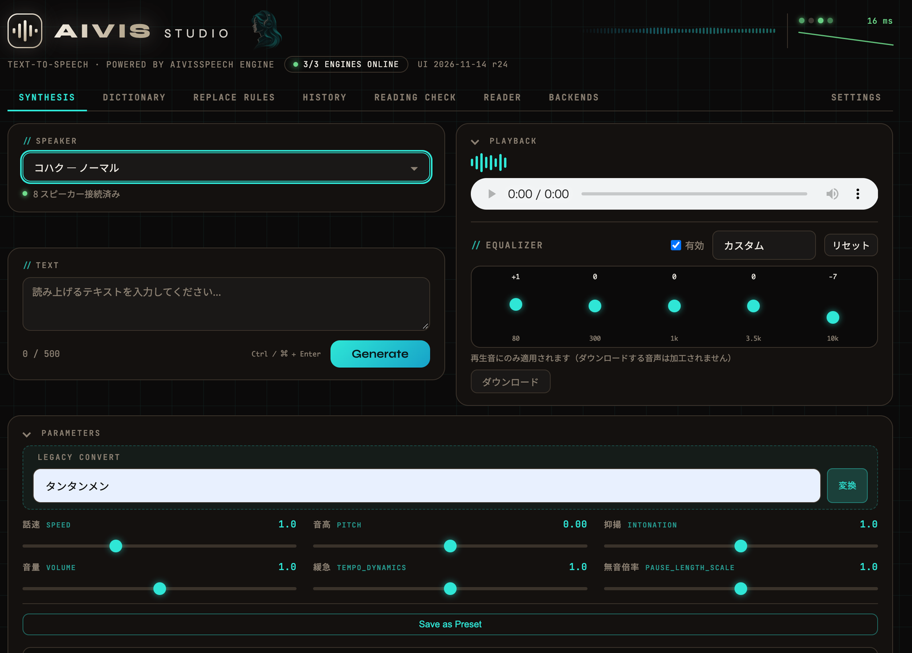

<p align="center">
  
</p>

<h1 align="center">AivisSpeech Studio デスクトップ版</h1>

<p align="center">
  <b>文字を入れるだけで、AIが感情豊かな声で読み上げる。</b><br>
  ダウンロードして、開くだけ。サーバーも、難しい設定もいりません。
</p>

<p align="center">
  
</p>

---

## できること

| | |
|---|---|
| **すぐ使える** | インストールして開けば、すぐに読み上げを始められます。専用の「かんたんモード」で、必要な操作だけを表示します。 |
| **自然で感情豊かな声** | 声の種類（話者）を選んで、文章を入れるだけ。話速、音高、抑揚、音量、緩急、無音の長さまで細かく調整できます。 |
| **読み間違いを直せる** | 辞書と置換ルールで、固有名詞や専門用語の読みを登録できます。一度直せば、次からその読みで話します。 |
| **履歴とプリセット** | 読み上げた内容は履歴に残ります。お気に入りの設定は、プリセットとして保存できます。 |
| **聞こえ方を整える** | 5バンドのイコライザーで、再生音の高音や低音を調整できます。 |
| **PCの中で完結** | 標準の使い方では、入力した文章はPCの外に出ません。アカウント登録も不要です。 |
| **無料** | 声を出す AivisSpeech は無料で使えます。 |

> サーバー版（ブラウザで使う `hit-aivis-webui` と `hit-aivis-router`）とは別の配布物です。サーバー版は、これまでどおり動いています。

## 対応環境

| | 状態 |
|---|---|
| Mac（Apple Silicon: M1 以降） | 動作を確認しています |
| Windows（64bit） | 作る準備はできています。まだ作って確かめていません |
| Intel Mac | 対応しません |

---

## はじめての人へ: 4つのステップ

PCが苦手でも大丈夫です。順番に、1つずつやってみましょう。
かかる時間は、ぜんぶで10分くらいです。

### ステップ1　まず「AivisSpeech」を入れる（声を出す本体）

このアプリは、声を出すときに **AivisSpeech（エーアイビス スピーチ）** という無料のソフトを使います。
先に、これを入れてください。

1. 次のページを開きます → https://aivis-project.com/
2. ダウンロードのリンクから、自分のPC（Mac か Windows）に合うものを選びます
3. ダウンロードできたら開いて、画面の言うとおりに「次へ」を押していきます

> もう入れてある人は、ステップ2へ進んでください。
> 入れ忘れても大丈夫です。このアプリを開くと、「AivisSpeech のインストールが必要です」と教えてくれます。

### ステップ2　このアプリを入れる

**Mac の人**

1. `AivisSpeech-Studio-…-mac-arm64.dmg` というファイルをダブルクリックします
2. 出てきた小さな窓の中の「AivisSpeech Studio」を、**「Applications」のフォルダにドラッグ**します（引っぱって、はなす）
3. 小さな窓は、閉じてかまいません

**Windows の人**

1. `AivisSpeech-Studio-…-win-x64.exe` というファイルをダブルクリックします
2. しばらく待つと、ひとりでに入ります（画面で押す場所はありません）

### ステップ3　開く

**Mac の人**

- 「Applications」の中の **AivisSpeech Studio** をダブルクリックします
- はじめてのときだけ「開発元が未確認のため開けません」と出ることがあります。こわれているわけではありません。次のようにすると、開けます。
  1. 画面の左上のリンゴのマーク → **「システム設定」** → **「プライバシーとセキュリティ」** を開く
  2. 下の方に出ている **「このまま開く」** を押す（パスワードを聞かれたら、PCのパスワードを入れます）

**Windows の人**

- スタートボタンを押して、**AivisSpeech Studio** を選びます
- 「WindowsによってPCが保護されました」と青い画面が出たら、**「詳細情報」** を押してから **「実行」** を押します。こわれているわけではありません。

### ステップ4　しゃべらせてみよう

1. もし「AivisSpeech のインストールが必要です」と出たら、「ダウンロードページを開く」を押して、ステップ1をやります。入れて **AivisSpeech を開く** と、このアプリが自動でつながります
2. もし「AivisSpeech を起動しますか？」と出たら、**「AivisSpeech を起動」** を押します
3. 画面の四角い場所に、読ませたい文章を書きます（例: 「こんにちは！」）
4. 再生のボタンを押すと、声が出ます

---

## こまったとき

| こうなった | こうしてみて |
|---|---|
| 声が出ない | PCの音量が小さくなっていないか見てください。それから AivisSpeech が開いているか見てください |
| 話す人（声の種類）の一覧が空っぽ | AivisSpeech を開いてから、このアプリを閉じて、もう一度開いてください |
| 「開発元が未確認」「PCが保護されました」と出た | ステップ3を見てください |
| 「AivisSpeech のインストールが必要です」と出た | ステップ1をやってください |

それでもだめなときは、おうちの人や詳しい人に、このページを見せてください。

---
---

## 開発者向け

ここから下は、このアプリを作る人向けの説明です。

### 仕組み

```
Electron
 ├─ 同梱ルーター (hit-aivis-router を PyInstaller で固めたもの)  127.0.0.1:<空きポート>
 │     └─ AivisSpeech Engine (ユーザーが別途インストール) 127.0.0.1:10101
 └─ 同梱の画面 (hit-aivis-webui の index.html)  ← 「かんたんモード」で表示
```

- 画面とルーターはサーバー版のファイルを**ビルド時にコピー**して使います（このリポジトリには入れません）。サーバー版の更新は `npm run prepare:vendor` で取り込めます。
- 接続先ポートと既定の表示モードは `preload.js` が localStorage に入れます（画面側は無改造です）。
- 設定・履歴などは OS のアプリデータ領域（Mac: `~/Library/Application Support/hit-aivis-desktop/router/`、Windows: `%APPDATA%\hit-aivis-desktop\router\`）に保存されます。ルーターのログは、その1つ上のフォルダにある `router.log` です。

### AivisSpeech が見つからないとき

起動時に AivisSpeech Engine（既定 `127.0.0.1:10101`）が応答しないと、ダイアログが出ます。

- **入っているが起動していない**: 「AivisSpeech を起動」で起動し、エンジンが立ち上がったら画面を自動で再読み込みします。
- **入っていない**: 「ダウンロードページを開く」で公式サイト（`https://aivis-project.com/`）を開きます。入れて起動してもらうと、自動で再接続します（最大10分待ちます）。
- 探す場所: Mac は `/Applications/AivisSpeech.app` と `~/Applications/`、Windows は `%LOCALAPPDATA%\Programs\AivisSpeech\AivisSpeech.exe` と `Program Files`。Windows の場所は公式の既定を想定したもので、実機では未確認です。

### 使い方（開発）

前提: Node.js、Python 3.12（ルーターのビルド用）、AivisSpeech アプリ（エンジン）。

```bash
npm install
npm run prepare:vendor   # 画面のコピー + ルーターのビルド(vendor/ に出力)
npm start                # AivisSpeech を起動してから
```

環境変数: `AIVIS_BACKEND_URLS`（エンジンの場所。既定 `http://127.0.0.1:10101`）、`AIVIS_ROUTER_BIN`（ルーター実行ファイルの差し替え）。

### インストーラーを作る

```bash
npm run prepare:vendor   # 画面とルーターを vendor/ に集める（初回・サーバー版を更新したとき）
npm run dist:mac         # dist/AivisSpeech-Studio-<版>-mac-arm64.dmg
npm run dist:win         # dist/AivisSpeech-Studio-<版>-win-x64.exe （Windows 上で実行する）
```

- **Mac 版**: Apple Silicon 専用（約136MB）。署名・公証はしていません（ad-hoc 署名のみ。`scripts/adhoc-sign.js`）。自分の Mac ではそのまま動きますが、ダウンロードして別の Mac で開くと「開発元が未確認」の警告が出ます。警告なしで配るには、Apple Developer での署名と公証が必要です。
- **アイコン**: `build/icon.png`（1024px）から、Mac 用と Windows 用が自動で作られます。

### Windows 版を作る

ルーターを固める PyInstaller は、動かしている OS 用のものしか作れません。そのため Mac では、Windows 用の `.exe` は作れません。次のどちらかで作ります。

1. **GitHub Actions（推奨）**: `.github/workflows/build.yml` が、Mac 版と Windows 版を同時に作ります。Actions タブの「Run workflow」で実行し、成果物（Artifacts）をダウンロードします。サーバー版の画面とルーター（どちらも公開リポジトリ）を取り込むので、ルーターの `desktop/` が push されている必要があります。
2. **Windows の PC で手作業**: Node.js と Python 3.12 を入れて、`npm install`、`npm run prepare:vendor`、`npm run dist:win` の順に実行します。

Windows 版は、まだ一度も作って動かしていません。署名なしなので、配ると SmartScreen の警告（「詳細情報」から「実行」）が出ます。

### これから

- 署名・公証（Mac）、コード署名（Windows）、自動更新
- 初回起動での「ローカルエンジン / Aivis Cloud（自前APIキー）」の選択。エンジンを別に入れなくても使えるようにするための案です
- 同梱 ffmpeg のライセンス確認（配布前に LGPL ビルドへ）
- 配布ページ（ダウンロード用のリンク）
